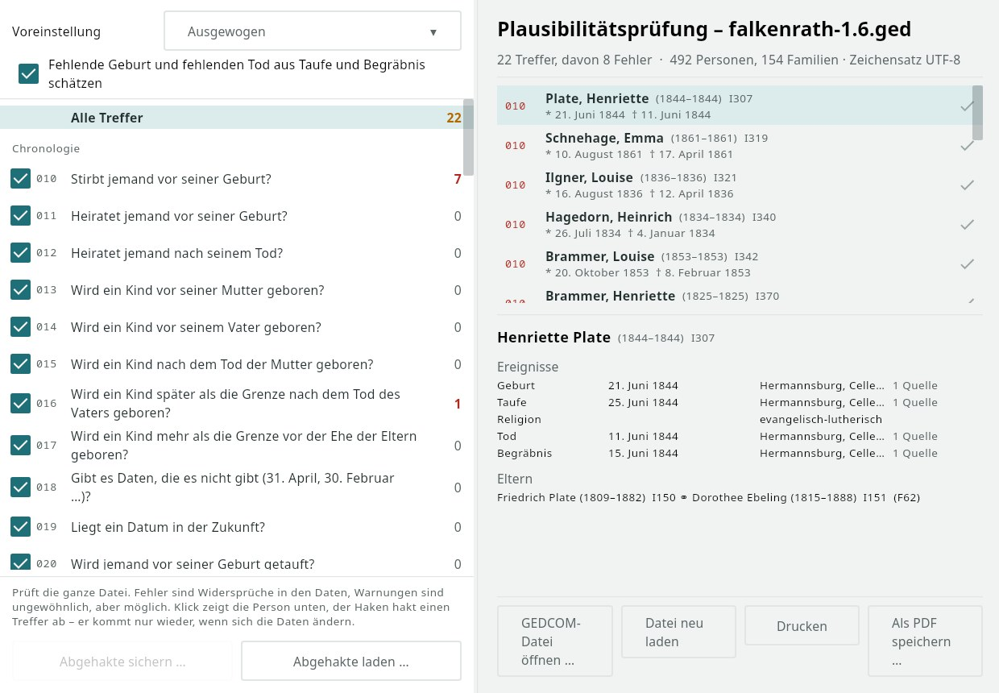
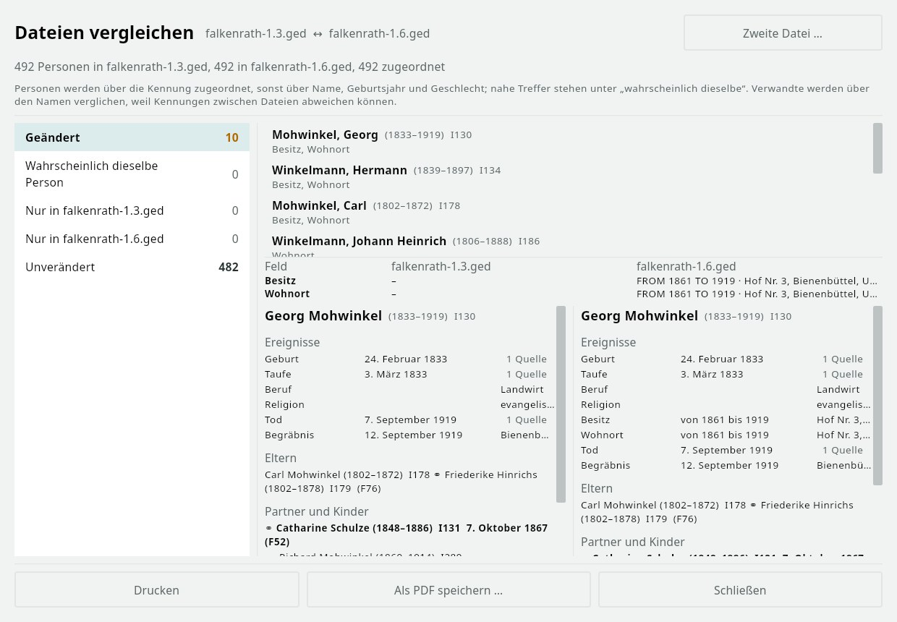

# gedaudit

[Deutsch](README.md) · **English**

<p align="center"></p>

gedaudit checks a GEDCOM file for contradictions and oddities: chronology, age limits, structure, names, sources, places and
the form of the file. 77 rules, each a question with a yes or no answer. The file is only read; nothing leaves your computer.
For Windows, Linux and macOS, interface in English, German, French, Dutch and Spanish.

Website with manual: [gedaudit.bgg-home.de](https://gedaudit.bgg-home.de/) · Packages: [Releases](https://github.com/thobgg/gedaudit/releases)

<p align="center"><br><b>Check</b>: rules in groups on the left, findings on the right, the person below (German interface).</p>

## Features

- Checking with presets (balanced, strict, generous, with sources, parish register), limits and severity per rule, estimating birth and death from baptism and burial.
- Ticking off findings; they only return when the data at that spot changes. Save and load the tick list.
- Person of a finding with events, parents, partners and children; for pairs both side by side. Ctrl+C copies the person text.
- Comparing two files: changed, only in one or the other, probably the same person.
- File structure: the tag tree per record type, GEDCOM-L, vendor tags and tags outside the standard highlighted.
- GEDCOM-L addendum: godparents and witnesses without a record (`_GODP`, `_WITN`), GOV identifier, postal code and Maidenhead locator at places, family status; pointers to location records (`_LOC`) that lead nowhere are reported.
- File header (program, submitter, version, file name, date) and the rules of GEDCOM 7; checked by the version in the header or, if you choose, as 5.5.1 or 7.0.
- Print and PDF. GEDCOM 5.5, 5.5.1 and 7; character sets UTF-8, UTF-16, ANSEL, ANSI.

<p align="center"><br><b>Comparing two files</b>: Falkenrath 1.3 against 1.6.</p>

## Related

The rules are the same as in the plausibility check of [wtWin, wtTux and wtMac](https://wtwin.bgg-home.de/), the desktop program for
webtrees. The shared core lives in the repository [app4webtrees](https://github.com/thobgg/app4webtrees) and is included here as a git
submodule; a rule improved there is improved here as well.

## Build

```bash
git clone --recursive https://github.com/thobgg/gedaudit.git
cd gedaudit
./gradlew :gedaudit:packageDeb        # Linux
./gradlew :gedaudit:packageInno       # Windows (Inno Setup 6)
./gradlew :gedaudit:packageDmg        # macOS
```

The build needs JDK 21 and the Android SDK (the shared core is a multiplatform library). Otherwise the packages are built by
GitHub Actions (`.github/workflows/pakete.yml`). Help texts and translations live in the submodule under `shared/src/desktopMain/resources/hilfe/`
and `shared/src/commonMain/composeResources/`.

## License

[GPL-3.0](LICENSE). The demo tree [Falkenrath](https://github.com/thobgg/falkenrath-demo-tree) in the pictures is CC0.
